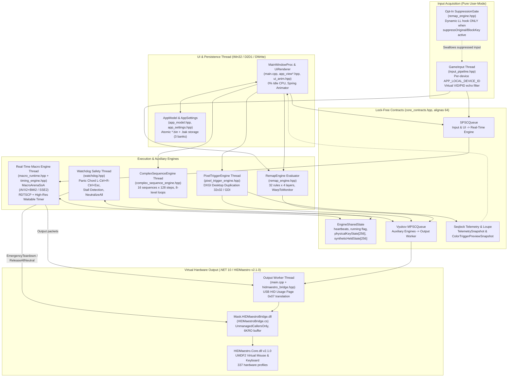

# Mask Engine Architecture

Mask is a pure user-mode (**Ring-3**) Windows C++23 input automation, remapping, complex sequencing, and screen-color trigger suite designed for deterministic sub-microsecond scheduling, zero hot-path allocations, and hardware-level HID emulation via Microsoft GameInput and HIDMaestro v2.1.0.

---

## 1. Design Principles

1. **Zero Ring-0 / Zero Hook-by-Default Input Monitoring:** Physical keyboard and mouse states are ingested through Microsoft **GameInput** (`GameInput.h`) on a dedicated input thread with per-device identity (`APP_LOCAL_DEVICE_ID`). Legacy `WH_KEYBOARD_LL` / `WH_MOUSE_LL` hooks remain uninstalled unless a user explicitly enables a Remap rule that suppresses original keystrokes (`SuppressionGate` in `include/remap_engine.hpp`).
2. **Hardware-Level Virtual Output (Zero `SendInput`):** All synthetic mouse and keyboard events are emitted over virtual HID pipes managed by **HIDMaestro v2.1.0** (`lib/HIDMaestro.Core.dll`, UMDF2 virtual HID driver) hosted inside a .NET 10 native-callable bridge (`src/bridge/HIDMaestroBridge.cs`, loaded dynamically via `hostfxr`).
3. **Zero Hot-Path Heap Allocations & Zero Mutex Contention:** The real-time macro engine communicates exclusively via 64-byte cache-line-aligned lock-free **SPSC** (`SPSCQueue<T, Capacity>`) and Vyukov **MPSC** (`MPSCQueue`) queues defined in `include/core_contracts.hpp`.
4. **Pure User-Mode Screen Sampling:** The Pixel Trigger Engine (`include/pixel_trigger_engine.hpp`) samples pixels strictly via Windows DXGI Desktop Duplication (`ID3D11Device` + `IDXGIOutputDuplication` into a persistent `32x32` `D3D11_USAGE_STAGING` texture) with a cached `32x32` GDI `DIBSection` + `BitBlt` fallback. It performs zero process memory reading and zero DLL injection.
5. **Event-Driven GPU UI with 0% Idle Overhead:** The Win32 + Direct2D/DirectWrite UI (`src/main.cpp`, `include/app_view.hpp`, `include/app_view_editors.hpp`, `include/ui_anim.hpp`) renders on demand (`kAnimTimerId` runs only while focused and actively animating springs) and supports unfocused throttling plus working-set memory trimming after 5 seconds minimized.
6. **Hardware Fail-Safe Safety:** An independent high-priority Watchdog (`include/watchdog.hpp`) monitors engine heartbeats, handles crashes/console signals, enforces `L-Ctrl + R-Ctrl + Esc` emergency stop, unhooks `SuppressionGate`, aborts auxiliary engines, and forces neutral HID reports across all virtual devices.

---

## 2. System Topology & Threading Model



---

## 3. Core Subsystems

### 3.1 Lock-Free Memory Contracts (`include/core_contracts.hpp`)
- **64-Byte Cache-Line Isolation:** Producers and consumers keep head/tail cursors, `EngineSharedState`, and telemetry blocks aligned to `kCacheLineSize` (`64` bytes) to eliminate false sharing.
- **Queues:**
  - `SPSCQueue<T, Capacity>` with strict `std::memory_order_acquire` / `std::memory_order_release` barriers for single-producer single-consumer streams.
  - Lock-free Vyukov `MPSCQueue` funneling `AuxOutputCommand` packets (`32` bytes) from auxiliary threads (`ComplexSequenceEngine`, `PixelTriggerEngine`, `RemapEngine`) to the dedicated Output Worker thread.
- **Data-Oriented Payloads:**
  - `MacroConfig` (`320` bytes static-asserted for `profiles*.bin` compatibility).
  - `ComplexSequenceConfig` (`16` slots, up to `128` `ComplexStep` entries per sequence).
  - `ColorTriggerConfig` (`8` trigger slots).
  - `RemapRuleConfig` (`32` rules across `4` layers).

### 3.2 Deterministic Sub-Microsecond Timing (`include/timing_engine.hpp`)
- **`TimingEngine`:** At startup, calibrates `__rdtscp()` against `QueryPerformanceFrequency()` / `QueryPerformanceCounter()` over a 50 ms calibration window using exact `_umul128` / `_udiv128` Q32.32 fixed-point arithmetic (zero floating-point drift on the hot loop).
- **Persistent High-Resolution Timer:** Allocates a single `CreateWaitableTimerExW(..., CREATE_WAITABLE_TIMER_HIGH_RESOLUTION, TIMER_ALL_ACCESS)` handle for coarse waits, then transitions cleanly into a bounded `__rdtscp()` + `_mm_pause()` micro-spin window according to the configured `spinPolicy` (`Auto`, `MaxPrecision`, `Eco`).
- **Observed Release `--self-test` Precision:** Measured `3.2938 GHz` TSC with `p50 = 19 ns`, `p99 = 19 ns`, `max = 19 ns`, and `20/20` samples `< 100 ns`.

### 3.3 SIMD Macro Runtime (`include/macro_runtime.hpp`)
- **`MacroArenaSoA`:** Structure-of-Arrays (SoA) layout organizing active macro slot deadlines and phases contiguously for SIMD scanning (**AVX2 + BMI2** fast path when supported, with automatic **SSE2** fallback).
- **Execution Modes:**
  1. `HoldToLoop` (continuous Dwell/Recovery while physical trigger is held)
  2. `InfiniteToggleLoop` (toggle start/stop on press)
  3. `RepeatNTimes` (deterministic N-cycle burst)
  4. `Sequence` (multi-step legacy macro sequence)
  5. `SocdPair` (last-win / opposing-direction resolution)
- **Guards & Humanization:** Enforces a strict `50 us` (`kMinPhaseMs = 0.05`) minimum dwell/recovery floor and supports optional deterministic `xorshift64*` micro-jitter.

### 3.4 GameInput Acquisition (`include/input_pipeline.hpp`)
- Reads physical devices via Microsoft **GameInput** without installing system-wide hooks.
- Maintains a 16-slot `PerDeviceInputState` table keyed by `APP_LOCAL_DEVICE_ID` so multi-keyboard and multi-mouse remap rules can discriminate hardware sources.
- Filters out synthetic self-echoes originating from Mask's own active virtual devices (`logitech-g502-hero` mouse and `keychron-q6` keyboard profiles by default).

### 3.5 HIDMaestro v2.1.0 Virtual Hardware Output (`include/hidmaestro_bridge.hpp`, `src/bridge/HIDMaestroBridge.cs`)
- `hidmaestro_bridge.hpp` resolves the local .NET 10 runtime via `hostfxr`, initializes `Mask.HIDMaestroBridge.dll`, and binds `[UnmanagedCallersOnly]` entry points (`SubmitMouse`, `SubmitKeyboard`, `ReleaseAllNeutral`, `EmergencyTeardown`, `QueryTelemetry`, `GetActiveHardwareIds`).
- `VkToHMKey` converts Win32 virtual keys (`0..255`) into **USB HID Usage Page `0x07`** (`HMKey`) scan bytes and modifier bitmasks (`HMKeyModifiers`).
- `HIDMaestroBridge.cs` maintains preallocated zero-allocation buffers (including a 6-key rollover buffer `s_keyRolloverBuffer`) and spin guards to drive `HMContext` / `HMController` UMDF2 devices across 337 vendor/device profiles. Running elevated claims the live virtual UMDF2 hardware pipes.

### 3.6 Auxiliary Engines
- **Complex Sequence Engine (`include/complex_sequence_engine.hpp`):** Dedicated event-driven thread running up to `16` workflows of up to `128` steps each (`Click key`, `Hold key`, `Release key`, `Move mouse`, `Move to spot`, `Scroll wheel`, `Wait`, `Wait for color`, `Start loop` / `End loop` up to 8 levels deep, `Open app`, `Run command`, `Switch layer`, `Toggle macro`). Supports `Once`, `Toggle`, and `Hold` triggers plus optional timing jitter.
- **Pixel Trigger Engine (`include/pixel_trigger_engine.hpp`):** Samples target screen coordinates via DXGI Desktop Duplication (`32x32` staging texture) or persistent `32x32` GDI `DIBSection`. Computes `ColorDistanceEuclidean`, supports `Color match` and `On change` detection modes, multi-monitor coordinates (`kMaxMonitors = 8`), `Always` / `Hold hotkey` / `Toggle hotkey` arming, configurable delay/hold/cooldown timings, and exports a lock-free `15x15` loupe via `ColorTriggerPreviewSnapshot` seqlock when the UI editor is visible.
- **Multi-Device Remap Engine & SuppressionGate (`include/remap_engine.hpp`):** Evaluates up to `32` rules across `4` layers (`Default` + 3 switchable layers), supports key remaps, blocking, layer switching (`Momentary`/`Toggle`), and multi-monitor cursor warping (`WarpToMonitor`), plus unlock policies (`Always`, `WhenLocked`, etc.). `IsProtectedSafetyVk` prevents blocking safety keys (`Esc`, `L-Ctrl`, `R-Ctrl`, Pause, Stop-All). `SuppressionGate` spins up `WH_KEYBOARD_LL` / `WH_MOUSE_LL` ONLY when active rules require swallowing physical events, and tears down automatically on pause/exit/panic.

### 3.7 Direct2D UI & Animation System (`src/main.cpp`, `include/app_view.hpp`, `include/app_view_editors.hpp`, `include/ui_anim.hpp`)
- **Rendering:** Pure native Direct2D (`d2d1.h`) + DirectWrite (`dwrite.h`) inside a dark-framed Win32 window (`1160x760` DIP default, `980x690` min), driven by `UiAnimator` (`SpringValue`, `SmoothValue`, `Full`/`Reduced`/`Off` animation quality, and 5 `AccentPreset` palettes: Amber, Cyan, Emerald, Violet, Crimson).
- **Editors:**
  - **Macro Editor:** Click-to-bind trigger/target chips, 5 execution modes, dwell/recovery/duty timing slider, burst repeat count, jitter controls.
  - **Trigger Bot Studio:** Plain-English behavior summary, `15x15` live color loupe comparing "Seeing now" vs "Target color", status pill (`Matched` / `Watching` / `Standby` / `Off`), `Pick color & spot` global eyedropper, `Screen center`, 6 quick color presets, `Color leeway` tolerance slider (`Very strict`..`Very wide`), arming/action controls, and multi-screen selector.
  - **Complex Sequence Builder:** Two-column studio with an indented, color-coded scrollable timeline on the left (visualizing nested loop indentation) and a step inspector + grouped 3-column step-type popover (`INPUT`, `TIMING & LOOPS`, `SYSTEM`) on the right.
  - **Remap Editor:** Device source picker (`Any`, `Keyboard`, `Mouse`, specific `APP_LOCAL_DEVICE_ID`), layer tabs, suppression toggle, target action, and monitor warp picker.
- **Settings & Persistence (`include/app_settings.hpp`, `include/app_model.hpp`):** Settings modal (General, Windows startup registry toggle, Appearance, Performance/Power modes, Safety Hotkeys, Hardware Profile IDs & Active Bank 1..3), system tray integration (`WM_APP_TRAY_ICON`), and atomic disk serialization with `.bak` recovery (`profiles*.bin`, `sequences*.bin`, `triggers*.bin`, `remaps*.bin`, `settings.bin`).

---

## 4. Repository Layout

```text
Mask/
├── CMakeLists.txt                   # C++23 AVX2/LTCG build + .NET bridge build & DLL staging
├── ARCHITECTURE.md                  # System architecture & concurrency specification
├── README.md                        # Overview, build instructions, controls, and licensing
├── LICENSE                          # Exclusive proprietary license (endrusmah)
├── .gitignore                       # Excludes build/, bin/obj/, backups, and *.bin profiles
├── lib/
│   └── HIDMaestro.Core.dll          # HIDMaestro v2.1.0 core runtime dependency
├── include/
│   ├── core_contracts.hpp           # SPSC/MPSC lock-free queues, EngineSharedState, binary structs
│   ├── timing_engine.hpp            # TSC calibration + High-Res Waitable Timer + spin loop
│   ├── input_pipeline.hpp           # GameInput multi-device acquisition & virtual echo filtering
│   ├── macro_runtime.hpp            # MacroArenaSoA AVX2/SSE2 runtime & 5 macro modes
│   ├── complex_sequence_engine.hpp  # 16x128 step workflow & nested loop engine
│   ├── pixel_trigger_engine.hpp     # DXGI Desktop Duplication / GDI color trigger & 15x15 loupe
│   ├── remap_engine.hpp             # Multi-device/layer remapper & opt-in SuppressionGate
│   ├── hidmaestro_bridge.hpp        # .NET 10 hostfxr bridge loader & VK -> HID Usage lookup
│   ├── watchdog.hpp                 # Independent panic chord & stall fail-safe thread
│   ├── app_settings.hpp             # Persistent preferences, power modes, Run-key integration
│   ├── app_model.hpp                # Item models, plain-English descriptions, atomic bank storage
│   ├── ui_anim.hpp                  # SpringValue / SmoothValue animator & 5 accent themes
│   ├── app_view.hpp                 # Direct2D/DirectWrite chrome, hit-testing, sidebar & macro view
│   └── app_view_editors.hpp         # Trigger Bot studio, 2-col Complex Sequence studio, Remap UI
└── src/
    ├── main.cpp                     # WinMain/mainCRTStartup, Win32 shell, tray, timers, threads
    └── bridge/
        ├── Mask.HIDMaestroBridge.csproj
        └── HIDMaestroBridge.cs      # Native-callable C# exports driving HIDMaestro.Core.dll
```
