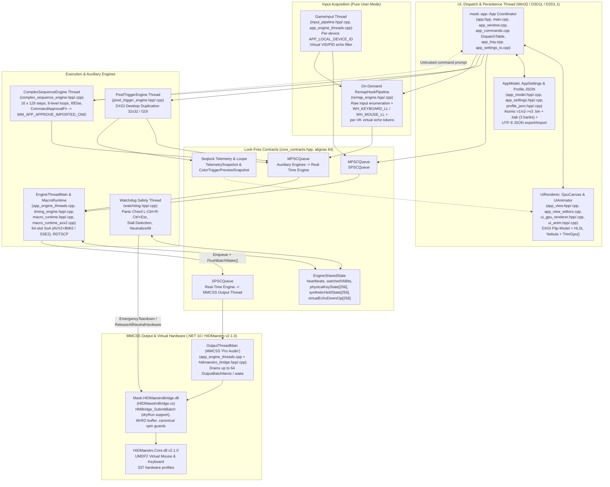

# Mask Engine Architecture

Mask is a pure user-mode (**Ring-3**) Windows x64 C++23 input automation, remapping, complex sequencing, and screen-color trigger suite designed for deterministic sub-microsecond scheduling, zero hot-path heap allocations, and hardware-level HID emulation via Microsoft **GameInput**, **Direct3D 11 / Direct2D 1.1**, and **HIDMaestro v2.1.0**.

---

## 1. Design Principles

1. **Zero Ring-0 / Zero Hook-by-Default Input Monitoring:** Physical keyboard and mouse states are ingested through Microsoft **GameInput** (`include/input_pipeline.hpp`, `src/input_pipeline.cpp`) and Win32 Raw Input (`GetRawInputDeviceList` in `src/remap_engine.cpp`) with per-device identity (`APP_LOCAL_DEVICE_ID` + VID/PID). `RemapHookPipeline` (`WH_KEYBOARD_LL` / `WH_MOUSE_LL`) remains completely uninstalled unless enabled remap rules explicitly require hook interception or suppression.
2. **Batched Hardware-Level Virtual Output (Zero `SendInput`):** Synthetic mouse and keyboard transitions enqueue lock-free `OutputBatchItem` (`48`-byte) frames into `EngineSharedState::outputBatchQueue`, drained by a dedicated **MMCSS `"Pro Audio"`** `OutputThreadMain` (`src/app_engine_threads.cpp`) into `.NET 10` (`Mask.HIDMaestroBridge.dll` via `HMBridge_SubmitBatch`) and **HIDMaestro v2.1.0** (`lib/HIDMaestro.Core.dll`, UMDF2 virtual HID driver).
3. **Zero Hot-Path Heap Allocations & Zero Mutex Contention:** Real-time threads communicate exclusively via 64-byte cache-line-aligned lock-free **SPSC** (`SPSCQueue<T, Capacity>`), Vyukov **MPSC** (`MPSCQueue<T, Capacity>`), and seqlock telemetry/preview snapshots defined in `include/core_contracts.hpp`.
4. **Modular `mask::app::App` Ownership (Zero Globals):** `include/app.hpp` defines `mask::app::App`, which owns every runtime subsystem (`sharedState_`, `timingEngine_`, `model_`, `animator_`, `renderer_`, `pixelEngine_`, `seqEngine_`, `remapEngine_`, `watchdog_`), worker threads, and `SRWLOCK`-guarded approval mailbox—eliminating legacy `g_Ui`/`g_SharedState`/`g_Animator`/`g_Renderer` global singletons. `App` is heap-allocated in `src/main.cpp` and dispatches window messages via `GWLP_USERDATA` and a single O(1) typed `UiAction` dispatch table (`App::DispatchTable()` in `src/app_commands.cpp`).
5. **Isolated SIMD & Hardened MSVC x64 Build:** `CMakeLists.txt` enforces MSVC-only Windows x64 C++23 with `/GS` buffer security checks enabled. `/arch:AVX2` codegen is isolated strictly to `src/macro_runtime_avx2.cpp`, while all remaining 22 C++ translation units compile cleanly without AVX2 and `src/macro_runtime.cpp` falls back automatically to portable SSE2.
6. **Pure User-Mode Screen Sampling:** `PixelTriggerEngine` (`include/pixel_trigger_engine.hpp`, `src/pixel_trigger_engine.cpp`) captures screen ROIs strictly via Windows DXGI Desktop Duplication (`ID3D11Device` + `IDXGIOutputDuplication` into a reusable `32x32` `D3D11_USAGE_STAGING` texture) with a cached `32x32` GDI `DIBSection` + `BitBlt` fallback.
7. **Focused-Only D3D11 + Direct2D 1.1 GPU UI:** `GpuCanvas` (`include/ui_gpu_renderer.hpp`, `src/ui_gpu_renderer.cpp`) composites Direct2D 1.1 + DirectWrite over a DXGI Flip-Model (`DXGI_SWAP_EFFECT_FLIP_DISCARD`) swapchain with an embedded HLSL Cosmic Nebula & Starfield shader. `kAnimTimerId` runs only while focused and animating (`0%` background CPU), and `TrimGpu()` (`IDXGIDevice3::Trim()`) + working-set trim drop GPU/RAM footprint on minimize or tray hide.
8. **Hardware Fail-Safe & Untrusted Import Safety:** An independent high-priority `Watchdog` (`include/watchdog.hpp`, `src/watchdog.cpp`) enforces the `L-Ctrl + R-Ctrl + Esc` panic chord, detects `400 ms` engine stalls, handles crashes/console signals, and resets all virtual HID controllers to neutral. Imported JSON sequences containing `LaunchProgram`/`RunCommand` steps are tagged `kSeqFlagUntrustedImport` and blocked until explicitly approved by the user (`WM_APP_APPROVE_IMPORTED_CMD`).

---

## 2. System Topology & Threading Model



---

## 3. Core Subsystems

### 3.1 Lock-Free Memory Contracts & Typed UI Actions (`include/core_contracts.hpp`, `include/ui_actions.hpp`)
- **64-Byte Cache-Line Isolation:** Producers and consumers keep head/tail cursors, `EngineSharedState`, and telemetry blocks aligned to `kCacheLineSize` (`64` bytes) to prevent false sharing across cores.
- **Lock-Free Queues:**
  - `MPSCQueue<InputTriggerEvent, 4096>`: Multi-producer physical transitions pushed from `GameInput` / polling into `EngineThreadMain`.
  - `SPSCQueue<MacroConfig, 256>`: UI -> Engine slot configuration updates.
  - `MPSCQueue<AuxOutputCommand, 1024>`: Vyukov MPSC ring (`32`-byte commands) funneling outputs from `ComplexSequenceEngine`, `PixelTriggerEngine`, and `RemapEngine` into `MacroRuntime::ProcessPendingQueues`.
  - `SPSCQueue<OutputBatchItem, 4096>`: `48`-byte `alignas(8)` trivially-copyable batch packets (matching C# `HMOutputBatchItem` byte offsets) dispatched by `InputDispatcher` to the MMCSS output thread.
- **Unrestricted Timing & Flags:**
  - `kMinimumPulseFloorNs = 0ULL`; `ClampPressNs` and `ClampReleaseNs` return raw nanoseconds untouched so `0 ms` / `<0.05 ms` / `>1,000 CPS` autoclicker timings pass cleanly to the runtime.
  - `kSeqFlagUntrustedImport` (`0x01U` in `ComplexSequenceConfig::reserved[0]`) tracks sequences imported from JSON with `LaunchProgram`/`RunCommand` steps.
  - `ColorTriggerMatchRule` (`AnyPixel` / `ZoneAverage` in `ColorTriggerConfig::reserved[0]`) and `ComplexStepKind` (`IfCheck`, `ElseBranch`, `EndIf`, etc.) live in trivially-copyable fixed-size structs (`MacroConfig` = `320` bytes static-asserted).
- **Typed UI Actions (`include/ui_actions.hpp`):** Strongly-typed `enum class ActionKind : uint16_t` and `struct UiAction { ActionKind kind; int16_t index; }` replace raw numeric action offsets across hit-testing and command routing.

### 3.2 Deterministic Sub-Microsecond Timing (`include/timing_engine.hpp`, `src/timing_engine.cpp`)
- **`TimingEngine`:** Calibrates `__rdtscp()` against `QueryPerformanceCounter()` over a 50 ms window using `_umul128` Q32.32 fixed-point multipliers (zero floating-point drift on the real-time loop).
- **Hybrid Pacing & MMCSS Scheduling:** Allocates a persistent `CREATE_WAITABLE_TIMER_HIGH_RESOLUTION` handle for coarse waits and transitions into a bounded `__rdtscp()` + `_mm_pause()` spin tail governed by `spinPolicy` (`Auto`, `MaxPrecision`, `Eco`). Provides `BoostThreadToProAudio()` / `RevertThreadProAudio()` (MMCSS `"Pro Audio"` + `THREAD_PRIORITY_TIME_CRITICAL`) for both `EngineThreadMain` and `OutputThreadMain`.
- **Jitter Telemetry:** Records actual-vs-target deltas into a pre-allocated 256-sample ring buffer and 4-bucket histogram (`<100ns`, `100-500ns`, `500ns-2us`, `>=2us`). Observed Release `--self-test`: `3.2938 GHz` TSC, `p50 = 9 ns`, `p99 = 29 ns`, `max = 29 ns` (`20/20 < 100 ns`; up to `9106 ns` `p99`/`max` on OS scheduler outlier runs).

### 3.3 SIMD Autoclicker Runtime & Isolated AVX2 (`include/macro_runtime.hpp`, `src/macro_runtime.cpp`, `src/macro_runtime_avx2.cpp`)
- **`MacroArenaSoA` & Isolated AVX2:** Evaluates 64 concurrent slot deadlines in contiguous cache-aligned arrays. `EvaluateExpiredMaskAvx2Bmi2Impl` is compiled exclusively in `src/macro_runtime_avx2.cpp` with `/arch:AVX2` (dispatched via runtime `__cpuid` check), while `src/macro_runtime.cpp` provides the portable SSE2 implementation and uses `_BitScanForward64` (zero global `/arch:AVX2` or `/GS-`).
- **Safe Unrestricted Autoclicking:** Supports `HoldToLoop` (Hold), `InfiniteToggleLoop` (Toggle), and `RepeatNTimes` (Burst) without artificial `50 us` or CPS caps. The state machine advances at most one press or release transition per slot per tick (`PHASE_1_DWELL_ACTIVE` -> `ReleaseSlotOutput` -> `PHASE_2_RECOVERY_WAIT` -> `EnterPressPhase`), preventing infinite zero-delay spin loops even at `0 ms`.
- **Verification & Humanization:** Supports optional `xorshift64*` micro-jitter (`Exact` / `±5%..±35%`) and includes `MacroRuntime::RunSimdEquivalenceSelfTest()` verifying bit-exact equivalence between AVX2+BMI2 and SSE2 paths.

### 3.4 GameInput Acquisition & Batched `InputDispatcher` (`include/input_pipeline.hpp`, `src/input_pipeline.cpp`)
- Ingests physical devices via `IGameInput` callbacks + adaptive polling into a 16-slot `PerDeviceInputState` table keyed by `APP_LOCAL_DEVICE_ID`, filtering out active synthetic virtual VID/PIDs (`0x046D:0xC08B` mouse, `0x3434:0x0160`/`0x0161` keyboard).
- Manages shared auto-reset wake events (`engineWakeEvent`, `watchdogWakeEvent`, `outputWakeEvent`).
- `InputDispatcher` runs in batch queue mode (`SetBatchQueueMode(true)`, `SetAutoWake(false)`), writing `OutputBatchItem` transitions into `outputBatchQueue` (stamping per-VK virtual echo tokens via `StampVirtualEchoToken`) and issuing one coalesced `FlushBatchWake()` at the end of each engine tick.

### 3.5 MMCSS Output Thread & HIDMaestro v2.1.0 Bridge (`src/app_engine_threads.cpp`, `include/hidmaestro_bridge.hpp`, `src/hidmaestro_bridge.cpp`, `src/bridge/HIDMaestroBridge.cs`)
- **`OutputThreadMain`:** Boosts itself via `TimingEngine::BoostThreadToProAudio()`, drains up to `64` `OutputBatchItem` entries per wake from `outputBatchQueue`, calls `HIDMaestroHost::SubmitBatchHardware(batch, count, dryRun)`, updates benchmark completion timestamps/counts (`benchLastCompleteTsc`, `benchLastCompleteToken`, `benchCompletedCount`, `benchTotalBatches`), and blocks on `outputWakeEvent` when empty.
- **CoreCLR Host & Batch Bridge:** `hidmaestro_bridge.cpp` loads .NET 10 via `hostfxr` and resolves `[UnmanagedCallersOnly]` exports (`HMBridge_Initialize`, `HMBridge_SubmitMouse`, `HMBridge_SubmitKeyboard`, `HMBridge_SubmitBatch`, `HMBridge_ReleaseAllNeutral`, `HMBridge_EmergencyTeardown`, `HMBridge_QueryTelemetry`, `HMBridge_GetActiveHardwareIds`) plus `VkToHMKey` USB HID Usage Page `0x07` translation.
- **`HMBridge_SubmitBatch`:** Acquires spin guards at most once per batch in canonical order (`mouse -> keyboard`), reuses pre-allocated `s_keyRolloverBuffer` (`6`-key rollover), supports un-elevated `dryRun != 0` for `--bench`, and drives `HIDMaestro.Core.dll` v2.1.0 (`337` hardware profiles; see [THIRD-PARTY-NOTICES.md](THIRD-PARTY-NOTICES.md)).
- **Dependency-Tracked Build (`MaskBridge`):** `CMakeLists.txt` tracks `Mask.HIDMaestroBridge.csproj`, `HIDMaestroBridge.cs`, and `HIDMaestro.Core.dll` via `bridge-<CONFIG>.stamp` (invoking `cmake -E env --unset=LIB dotnet build`) so incremental C++ builds skip redundant `.NET` compilation.

### 3.6 Auxiliary Engines & Safety Gates
- **Complex Sequence Engine (`include/complex_sequence_engine.hpp`, `src/complex_sequence_engine.cpp`):**
  - Event-driven worker (`0.00%` CPU while idle) running up to `16` sequences × `128` steps, `8`-level nested loops, and structured `IfCheck` / `ElseBranch` / `EndIf` conditionals (`KeyHeld`, `ColorMatches`, `LayerIs`, `UnlockStateIs`, `MacroActive`, `RandomChance`, plus Negate).
  - Preserves uncapped step durations (`0 ms` and arbitrarily large `uint32_t` values) and `kSeqFlagUntrustedImport`.
  - **Untrusted Import Command Gate:** When a sequence flagged `kSeqFlagUntrustedImport` reaches `LaunchProgram` or `RunCommand`, the worker parks at `0.00%` CPU on `wakeEvent_` and triggers `CommandApprovalFn` -> `App::QueueCommandApproval` (`32`-slot `SRWLOCK` ring) -> `WM_APP_APPROVE_IMPORTED_CMD` `MessageBoxW` prompt -> `ResolveCommandApproval(seqIdx, allowAndTrust)`.
  - Includes `RunControlFlowSelfTest()` and `RunSaveMigrationSelfTest()`.
- **Pixel Trigger Engine (`include/pixel_trigger_engine.hpp`, `src/pixel_trigger_engine.cpp`):**
  - Samples screen coordinates via DXGI Desktop Duplication (`32x32` staging texture) or persistent `32x32` GDI `DIBSection`.
  - Supports `MatchColor` and `ColorChanged` modes, `AnyPixel` and `ZoneAverage` match rules, up to `8` monitors, `AlwaysArmed` / `WhileArmHeld` / `ToggleArmed` arming, uncapped `delayMs`/`holdMs`/`cooldownMs`, and a lock-free `15x15` `ColorTriggerPreviewSnapshot` seqlock when the Trigger Bot editor or eyedropper is active.
  - Includes `RunTriggerSelfTest()` (`1.02–1.04 us/frame`) and `RunSaveMigrationSelfTest()` (`v1 -> v2`).
- **Remap Engine & `RemapHookPipeline` (`include/remap_engine.hpp`, `src/remap_engine.cpp`):**
  - Evaluates `32` rules across `4` layers (`RemapKey`, `BlockKey`, `ShiftLayerHold`, `ToggleLayer`, `ToggleUnlockState`, `WarpToMonitor`) with unlock policies (`Always`, `WhenUnlocked`, `WhenLocked`).
  - Enumerates physical HID devices immediately via Win32 Raw Input (`GetRawInputDeviceList`, filtering virtual/RDP pseudo-devices) and correlates them with GameInput `APP_LOCAL_DEVICE_ID` / VID:PID.
  - Dynamically installs/uninstalls `WH_KEYBOARD_LL` / `WH_MOUSE_LL` on a dedicated message-pumped hook thread **only** when active rules require interception or suppression, validates synthetic outputs via per-VK virtual echo tokens (`ConsumeVirtualEchoToken`), protects safety keys (`IsProtectedSafetyVk`), and includes `RunRemapSelfTest()` + `RunSaveMigrationSelfTest()`.
- **Watchdog (`include/watchdog.hpp`, `src/watchdog.cpp`):**
  - Samples `heartbeatCounter` every `25 ms` (`400 ms` stall threshold), listens for `emergencyPanicTriggered` (`L-Ctrl + R-Ctrl + Esc`), installs SEH crash and console control handlers, runs `AuxCleanupCallback`, and forces neutral HID output / teardown across virtual controllers.

### 3.7 Application Coordinator, Command Dispatch & Persistence (`include/app.hpp`, `src/app_*.cpp`, `src/profile_json.cpp`)
- **Modular App Files:**
  - `src/main.cpp`: Parses `--self-test`, `--bench`, `--relaunch`, `--minimized`, attaches console for CLI modes, enforces single-instance mutex (`kMutexName`), sets Per-Monitor V2 DPI awareness, and heap-allocates `mask::app::App`.
  - `src/app_window.cpp`: `App::Run`, `RunGuiLoop`, `MainWindowProc` (`GWLP_USERDATA`), focus-aware timer cadence, eyedropper sampling, inline text/number editing, Windows session-lock handling (`WM_WTSSESSION_CHANGE`), and `WM_APP_APPROVE_IMPORTED_CMD` approval dialog loop.
  - `src/app_commands.cpp`: Single O(1) `std::array<CommandFn, static_cast<size_t>(ActionKind::Count)>` dispatch table (`DispatchTable()` / `DispatchAction`) plus Win32 `GetSaveFileNameW` / `GetOpenFileNameW` JSON export/import handlers.
  - `src/app_tray.cpp` & `src/app_settings_io.cpp`: Win11 DWM chrome, DPI-aware `LoadImageW(IDI_MASK_ICON)` icon loading, tray icon/menu/restore, 5s minimize working-set trim (`kTrimMemTimerId`), `RestartAsAdministrator`, and engine/model sync.
- **Versioned Persistence & Migration (`src/app_model.cpp`, `src/app_settings.cpp`):**
  - Crash-safe atomic `.tmp` -> `ReplaceFileW` -> `.bak` writes across 3 profile banks (`Bank 1..3`) stored alongside the executable (with `%LOCALAPPDATA%\Mask\` fallback).
  - Binary format migrations preserving unrestricted timings: `profiles*.bin` (`v1/v2 -> v3`, mapping legacy `MacroMode::Sequence`/`SocdPair` cleanly into Autoclicker modes), `sequences*.bin` (`v1 -> v2`), `triggers*.bin` (`v1 -> v2`), `remaps*.bin` (`v1 -> v2`), and `settings.bin` (`v1 -> v2`).
- **JSON Import/Export (`include/profile_json.hpp`, `src/profile_json.cpp`):** Zero-dependency UTF-8 JSON serializer/parser (`kProfileJsonSchemaVersion = 2U`) supporting full bank round-trips (`macros`/`autoclickers`, `sequences`, `triggers`, `remaps`) and automatic `kSeqFlagUntrustedImport` tagging on imported `LaunchProgram`/`RunCommand` steps.

### 3.8 D3D11 Flip-Model + Direct2D 1.1 + HLSL GPU UI (`include/ui_gpu_renderer.hpp`, `src/ui_gpu_renderer.cpp`, `include/ui_anim.hpp`, `src/ui_anim.cpp`, `include/app_view.hpp`, `src/app_view.cpp`, `src/app_view_editors.cpp`)
- **`GpuCanvas`:** Direct3D 11 (`D3D11_CREATE_DEVICE_BGRA_SUPPORT`) + DXGI 1.2/1.3 Flip-Model swapchain (`DXGI_SWAP_EFFECT_FLIP_DISCARD`, `BufferCount = 2`), embedded `kCosmicNebulaHlsl` fullscreen-triangle + FBM Cosmic Nebula & Starfield shader compiled once via `D3DCompile` (with clean gradient fallback and DXGI device-lost recovery), Direct2D 1.1 `ID2D1DeviceContext` + DirectWrite (`Segoe UI Variable` / `Cascadia Mono` with `tnum` tabular figures), and `TrimGpu()` (`IDXGIDevice3::Trim()`).
- **`UiAnimator`:** Frame-rate-independent `SpringValue` & `SmoothValue` primitives (`kSlotAnimTotal = 120` slots across Autoclickers, Sequences, Triggers, Remaps), 5 Cosmic palettes (`Cosmic Cyan`, `Deep Sapphire`, `Ice Starlight`, `Nebula Violet`, `Aurora Teal`), and `Full` / `Reduced` / `Off` quality modes that freeze ambient shader drift and stop `kAnimTimerId` when unfocused (`0%` background CPU).
- **`UiRenderer`:** Renders the `Workspace` sidebar (`All`/`Auto`/`Seq`/`Trig`/`Map`), Autoclicker editor (unrestricted CPS/ms + amber warning banner + cosmic oscilloscope), 2-column Sequence studio (nested indentation + conditional badges + untrusted-import badge), Trigger Bot Studio (`15x15` loupe + `Any Pixel`/`Zone Average`), Remap editor, 5-tab Settings overlay (with `Export JSON` / `Import JSON` and live Hardware diagnostics), and `+ New` modal—bridging typed `UiAction`s to animator slot keys via `EncodeUiActionKey`/`DecodeUiActionKey`. *(The legacy `include/app_view_editors.hpp` header was retired; editor rendering now lives in `src/app_view_editors.cpp` declared in `include/app_view.hpp`.)*

### 3.9 Verification & Benchmark Harnesses (`src/app_selftest.cpp`)
- **`--self-test` (`App::RunSelfTest`):** Verifies TSC calibration, timer pacing jitter, `MacroRuntime::RunSimdEquivalenceSelfTest`, `ComplexSequenceEngine::RunControlFlowSelfTest`, `PixelTriggerEngine::RunTriggerSelfTest`, `RemapEngine::RunRemapSelfTest`, all 5 binary save migrations (`Profiles`, `Sequences`, `Triggers`, `Remaps`, `Settings`), and `RunProfileJsonSelfTest`.
- **`--bench` (`App::RunBenchmark`):** Exercises 500-sample end-to-end input-to-output latency (`~4.4–4.5 us` p50) and 10,000-click / 20,000-report batched output throughput (`~0.62 ms`, `15.8M–16.3M clicks/sec`) across `[CoreCLR HMBridge_SubmitBatch Dry-Run Pipeline]` (or `[Live HIDMaestro UMDF2 Hardware]` when elevated).

---

## 4. Repository Layout

```text
Mask/
├── CMakeLists.txt                   # MSVC-only x64 C++23 build, isolated AVX2 TU, /GS, MaskBridge
├── README.md                        # Overview, measured benchmarks, features, build & safety
├── ARCHITECTURE.md                  # System architecture, concurrency topology & module map
├── LICENSE                          # Exclusive proprietary license (endrusmah)
├── THIRD-PARTY-NOTICES.md           # Attributions for HIDMaestro (MIT), usbip-win2, DsHidMini
├── .gitignore                       # Excludes build/, bin/obj/, backups, temp .obj & *.bin files
├── assets/
│   └── mask.ico                     # Multi-resolution application icon (16..256 px)
├── lib/
│   └── HIDMaestro.Core.dll          # HIDMaestro v2.1.0 core runtime dependency
├── resources/
│   ├── mask.rc                      # Win32 icon & VS_VERSION_INFO resource script
│   └── resource.h                   # Resource ID & version resource macros
├── include/
│   ├── app.hpp                      # mask::app::App coordinator (owns all subsystems, zero globals)
│   ├── app_model.hpp                # AppModel, ItemKind, unrestricted timing math & v3 storage
│   ├── app_settings.hpp             # AppSettings (v1->v2), power/spin modes, Windows Run-key
│   ├── app_view.hpp                 # Cosmic theme tokens, EncodeUiActionKey, UiRenderer declarations
│   ├── complex_sequence_engine.hpp  # 16x128 sequences, 8-level loops, If/Else, approval gate
│   ├── core_contracts.hpp           # SPSC/MPSC queues, OutputBatchItem, EngineSharedState
│   ├── hidmaestro_bridge.hpp        # .NET 10 hostfxr bridge loader & VK -> HID Usage lookup
│   ├── input_pipeline.hpp           # GameInput multi-device acquisition & batched InputDispatcher
│   ├── macro_runtime.hpp            # MacroArenaSoA declarations & AVX2/SSE2 runtime interface
│   ├── pixel_trigger_engine.hpp     # DXGI Desktop Duplication / GDI color trigger & 15x15 loupe
│   ├── profile_json.hpp             # UTF-8 JSON schema v2 bank export/import & self-test
│   ├── remap_engine.hpp             # Multi-device/layer remapper, Raw Input & RemapHookPipeline
│   ├── timing_engine.hpp            # TSC calibration, High-Res Waitable Timer & MMCSS Pro Audio
│   ├── ui_actions.hpp               # Strongly-typed ActionKind enum & UiAction payload
│   ├── ui_anim.hpp                  # SpringValue / SmoothValue animator & 5 cosmic palettes
│   ├── ui_gpu_renderer.hpp          # GpuCanvas (D3D11 Flip-Model, D2D1.1, DWrite, TrimGpu)
│   └── watchdog.hpp                 # Independent panic chord, SEH/console & stall fail-safe
└── src/
    ├── main.cpp                     # Slim CLI/GUI entry point, mutex, DPI awareness & heap App
    ├── app_window.cpp               # Win32 window loop, timers, eyedropper & command approval UI
    ├── app_commands.cpp             # Single O(1) UiAction DispatchTable & JSON file dialogs
    ├── app_tray.cpp                 # Win11 DWM chrome, DPI icons, tray lifecycle & 5s trim
    ├── app_settings_io.cpp          # Engine/model sync, OutputWorker, toast & admin relaunch
    ├── app_engine_threads.cpp       # EngineThreadMain, MMCSS OutputThreadMain & GameInput thread
    ├── app_selftest.cpp             # --self-test & --bench verification harnesses
    ├── app_model.cpp                # Item descriptions, timing math, v1/v2->v3 binary storage
    ├── app_settings.cpp             # Settings sanitization, atomic v1->v2 migration & Run-key
    ├── app_view.cpp                 # D2D sidebar, Autoclicker editor & glowing oscilloscope
    ├── app_view_editors.cpp         # Sequence studio, Trigger Bot studio, Remap, Settings & +New
    ├── profile_json.cpp             # Zero-dependency UTF-8 JSON parser/serializer & trust flags
    ├── ui_anim.cpp                  # Spring/smooth stepping, ripple physics & idle-zero logic
    ├── ui_gpu_renderer.cpp          # Embedded kCosmicNebulaHlsl shader, D3D11/D2D1.1 rendering
    ├── timing_engine.cpp            # TSC/QPC calibration, hybrid sleep-spin & MMCSS Pro Audio
    ├── hidmaestro_bridge.cpp        # CoreCLR hostfxr resolution & HMBridge_SubmitBatch wrapper
    ├── input_pipeline.cpp           # GameInput callbacks, echo suppression & OutputBatchItem enqueue
    ├── macro_runtime.cpp            # SSE2 deadline scan, 0 ms autoclicker state machine & jitter
    ├── macro_runtime_avx2.cpp       # Isolated /arch:AVX2 + BMI2 deadline scanner TU
    ├── pixel_trigger_engine.cpp     # DXGI/GDI ROI sampling, MatchColor/ColorChanged & v2 migration
    ├── complex_sequence_engine.cpp  # Sequence worker, conditionals, approval gate & v2 migration
    ├── remap_engine.cpp             # Raw Input inventory, RemapHookPipeline & v2 migration
    ├── watchdog.cpp                 # Heartbeat stall monitor, panic chord & neutral teardown
    └── bridge/
        ├── Mask.HIDMaestroBridge.csproj
        └── HIDMaestroBridge.cs      # UnmanagedCallersOnly C# exports & HMBridge_SubmitBatch
